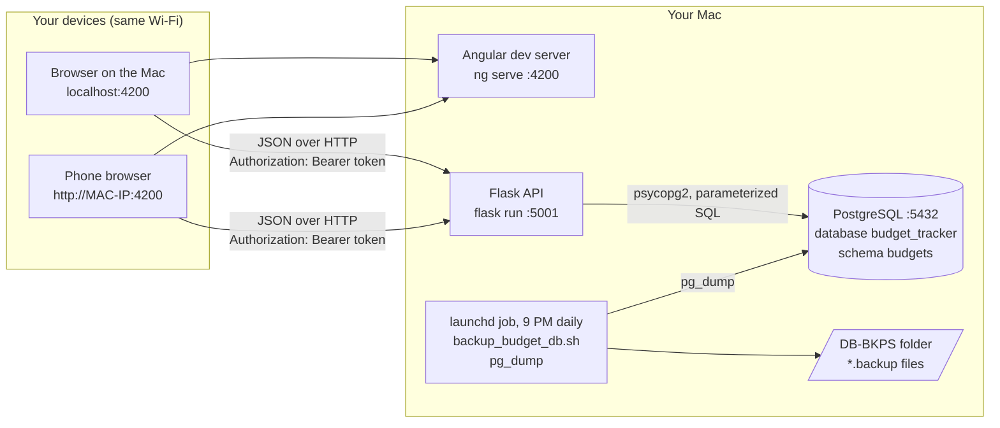
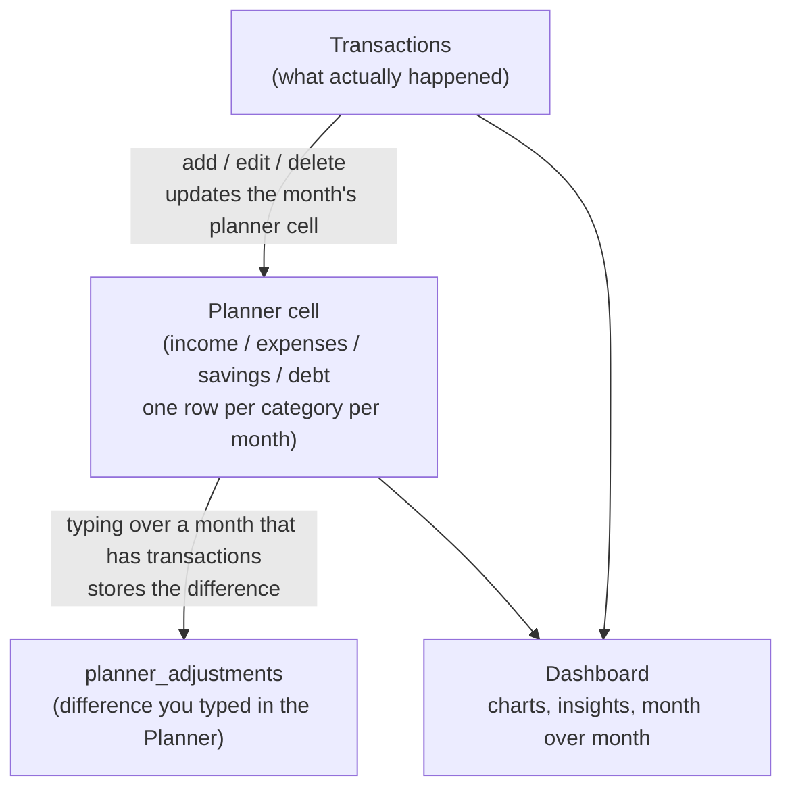
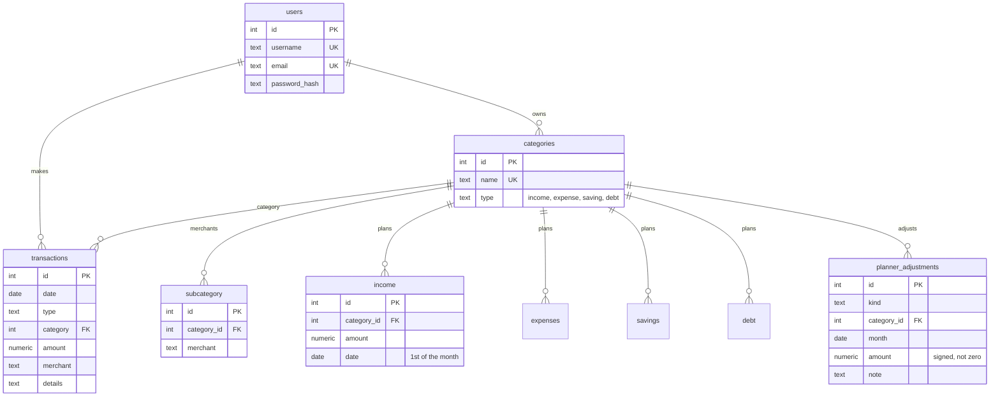
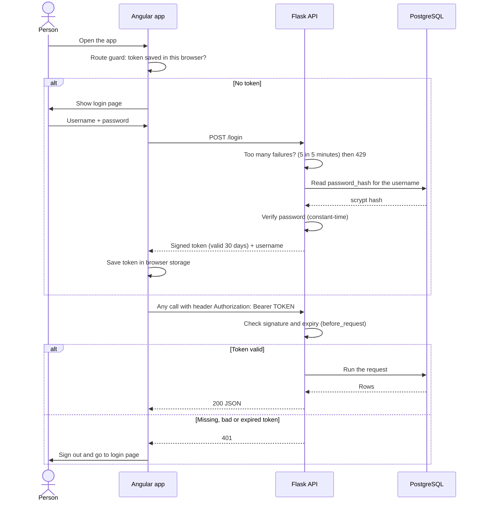

<!-- FILE: README.md  (REPLACE existing file at the repository root: FinancePlanner/README.md) -->
# FinancePlanner (Budget Tracker)

A personal budget app for two people: plan the month in a spreadsheet-style **Planner**, log real spending in **Transactions**, and see the picture on the **Dashboard**. Everything runs locally on one Mac; nothing is hosted.

| Part | Technology | Folder | Default address |
|---|---|---|---|
| UI | Angular 20, Angular Material, AG Grid 34, AG Charts | `budget_tracker_ui/` | http://localhost:4200 |
| API | Python, Flask, psycopg2 | `BudgetTracker.Service.API/` | http://localhost:5001 |
| Database | PostgreSQL (schema `budgets`) | not in the repo | localhost:5432 |

Port 5001 is used for the API because macOS AirPlay Receiver takes port 5000.

---

## Contents

1. [Architecture](#architecture)
2. [Running everything](#running-everything)
3. [UI](#ui)
4. [API](#api)
5. [Database](#database)
6. [Authentication](#authentication)
7. [Backups and restore](#backups-and-restore)
8. [Changing the backup schedule (launchctl)](#changing-the-backup-schedule-launchctl)
9. [Troubleshooting](#troubleshooting)
10. [Known limits](#known-limits)

---

## Architecture



The browser loads the Angular app from `ng serve`, then the app calls the Flask API directly. The API address is built from the host the page was opened from, so the same build works on the Mac and on a phone.

### How the money model fits together



Rule of thumb: **planner cell = transactions + adjustments**. Adding a transaction raises that month's planner cell by the amount; deleting one lowers it; editing one corrects it by the difference. Typing a new amount in the Planner for a month that already has transactions asks you to confirm first, then records the difference as an adjustment so nothing is silently lost.

---

## Running everything

Open three Terminal tabs.

**1. Database.** PostgreSQL must be running (Homebrew: `brew services start postgresql@15`, or open Postgres.app).

**2. API**
```bash
cd BudgetTracker.Service.API
source .venv/bin/activate              # your Python virtual environment
flask run --host 0.0.0.0 --port 5001
```
`--host 0.0.0.0` lets your phone reach it. Use `--host 127.0.0.1` if you only use the Mac.

**3. UI**
```bash
cd budget_tracker_ui
npm install                            # first time only
ng serve --host 0.0.0.0
```

Open http://localhost:4200. On a phone on the same Wi-Fi, open `http://<your-mac-ip>:4200` (find the address with `ipconfig getifaddr en0`).

Quick health check for the API:
```bash
curl http://localhost:5001/getHandshake       # prints: Test Successful
```

---

## UI

Folder: `budget_tracker_ui/src/app/`

| Page (route) | Folder | What it does |
|---|---|---|
| Dashboard (`/home`, `/`) | `home/` | Charts for a date range, plus insights (savings rate, year over year, unusual spending, large transactions) and month over month |
| Planner (`/planner`) | `budget-planner/` | Editable grid of planned income, expenses, savings and debt by category and month |
| Transactions (`/transactions`) | `transactions/` | Add a transaction, category donut with merchants, searchable grid with Edit/Delete buttons, Find entry, Categories, Export CSV |
| Login (`/login`) | `auth/` | Sign-in page, shown only when the API requires login |

Other folders: `shared/` (API address, design tokens, grid and chart themes), `interceptor/` (loading indicator), `services/`.

**Where the API address is set:** `src/app/shared/api-config.ts` (this repo may name it `app-config.ts`). It uses the host the page was opened from plus one port number:
```ts
const API_PORT = 5001;
```
Change that number only if you move the API to another port.

**Build for production** (output goes to `dist/`):
```bash
ng build
```

**Tests:** `ng test` (the spec files are the default stubs).

---

## API

Folder: `BudgetTracker.Service.API/`

```
app.py                      all routes
set_password.py             sets a user's login password (hidden prompt)
Database/DBConnector.py     opens one PostgreSQL connection per request
Database/*.sql              one-time database scripts (see Database)
Utils/BudgetRepository.py   all SQL for the app
Utils/InsightsService.py    dashboard insights and month over month
Utils/AuthUtil.py           password hashing, tokens, lockout
Utils/RequestUtil.py        request parsing and validation
appsettings.json            database connection and login switches (you create this)
auth_secret.key             login signing key, created automatically (in .gitignore)
```

### Settings: `appsettings.json`

```json
{
  "db_conn": {
    "host": "localhost",
    "port": 5432,
    "database": "budget_tracker",
    "user": "your_db_user",
    "password": "your_password"
  },
  "auth_required": true
}
```

| Key | Meaning |
|---|---|
| `db_conn` | PostgreSQL connection. `connect_timeout` (seconds, default 5) is optional |
| `auth_required` | `true` = every call needs a login token. Missing or `false` = no login, as before |
| `auth_secret` | Optional signing key (32+ characters). If absent, the key in `auth_secret.key` is used |
| `auth_token_days` | Optional. How long a login lasts. Default 30 |

Keep `appsettings.json` out of git because it holds your database password.

### Endpoints

All routes are listed below. Existing routes keep their original request and response shapes; new ones were added alongside them. Errors come back as JSON `{"error": "..."}` with a real HTTP status (400 bad input, 401 not signed in, 404 not found, 409 duplicate, 503 database unreachable).

| Route | Method | Purpose |
|---|---|---|
| `/getHandshake` | GET | Health check (always open) |
| `/login` | POST | Sign in, returns a token (always open) |
| `/me` | GET | Who am I / is login on |
| `/users` | GET | Users for the "Paid by" list |
| `/categories` | GET | All categories |
| `/saveCategory` | POST | Add a category (409 if the name exists) |
| `/categoryMappings` | GET | Every category with its merchants |
| `/getsubcategory`, `/savesubcategory` | POST | Merchants of a category; add a merchant |
| `/income`, `/expenses`, `/savings`, `/debt` | POST | Planner data for a year |
| `/updateSrc` | POST | Save a planner cell (records an adjustment when needed) |
| `/plannerMonthActivity` | POST | Read-only: what a planner cell is made of (used for the confirm dialog) |
| `/transactions` | POST | Transactions for a year |
| `/saveTransaction` | POST | Add a transaction (updates the planner cell) |
| `/searchTransactions` | POST | Search recent entries by text |
| `/updateTransaction` | POST | Edit a transaction (corrects the planner cell) |
| `/deleteTransaction` | POST | Delete a transaction (subtracts it from the planner cell) |
| `/summaryChart`, `/subCharts` | POST | Dashboard chart data |
| `/insights` | POST | Savings rate, year over year, unusual spending, large transactions |
| `/monthOverMonth` | POST | Month-by-month comparison |

---

## Database

PostgreSQL, schema `budgets`. Tables:



`expenses`, `savings` and `debt` have the same columns as `income`.

Rules the database enforces:
- One planner row per category per month in each planner table (unique indexes `*_category_month_uq`).
- `transactions.category` must be a real category (`transactions_category_fkey`).
- Transaction type and category type are one of `income`, `expense`, `saving`, `debt`.

### One-time scripts (already applied; keep for rebuilding)

Run in this order in your SQL editor, one statement at a time (the editor splits on semicolons, so avoid `DO $$` blocks and `BEGIN/COMMIT`):

| Script | What it does |
|---|---|
| `Database/phase2_constraints.sql` | Unique planner-month indexes (and the category foreign key) |
| `Database/phase3_adjustments.sql` | Creates `budgets.planner_adjustments` |
| `Database/phase3_gap_report.sql` | Read-only check: planner vs transactions. Should return 0 rows |
| `Database/phase3_backfill.sql` | Recorded old gaps as "Historical backfill" adjustments |
| `Database/phase4_auth.sql` | Adds `budgets.users.password_hash` |

Handy queries:
```sql
-- Does the planner still agree with transactions and adjustments? (should be 0 rows)
-- run the contents of Database/phase3_gap_report.sql

SELECT count(*) FROM budgets.transactions;
SELECT username FROM budgets.users;
```

---

## Authentication

Two people (Sharath and Soundarya) sign in with a username and password. Login is **only enforced when `"auth_required": true`** is in `appsettings.json`.



How it works:
- Passwords are stored as **scrypt** hashes in `budgets.users.password_hash`, never as plain text.
- A token is a signed (HMAC-SHA256) package of user id, username and expiry. The signing key is `auth_secret` in `appsettings.json`, or the file `BudgetTracker.Service.API/auth_secret.key` (created on first start, permissions 600, in `.gitignore`).
- `/login` and `/getHandshake` stay open. Every other route needs the token when login is on.
- 5 wrong passwords within 5 minutes locks that attempt out for a while (kept in memory, so restarting the API clears it).

### Set or change a password

Run this in your own Terminal (the password is typed at a hidden prompt, never put it in chat or in a file):
```bash
cd BudgetTracker.Service.API
source .venv/bin/activate
python set_password.py
```
Enter the username (not case-sensitive), then the password twice.

### Turn login on or off

Edit `BudgetTracker.Service.API/appsettings.json`, set `"auth_required": true` (or `false`), then restart the API.

### Sign everyone out

Delete `BudgetTracker.Service.API/auth_secret.key` and restart the API. A new key is created and every existing token stops working. (If you set `auth_secret` in `appsettings.json`, change that value instead.)

---

## Backups and restore

A nightly job runs `pg_dump` and saves a compressed backup (custom format, `.backup`). Backups older than 30 days are deleted.

| Item | Location |
|---|---|
| Script | `/Users/sharathchanderp/bin/backup_budget_db.sh` |
| Schedule | `/Users/sharathchanderp/Library/LaunchAgents/com.budgettracker.backup.plist` |
| Backup files | `/Users/sharathchanderp/Documents/Projects/BudgetTracker/DB-BKPS/budget_tracker-YYYY-MM-DD_HHMM.backup` |
| Error log | `/tmp/budget_backup.err` |
| Database password | `~/.pgpass` (permissions 600) so the script never needs it typed |

### One-time setup

1. `~/.pgpass`, one line, typed in your own editor:
   ```
   localhost:5432:budget_tracker:sharathchanderp:YOUR_PASSWORD
   ```
   then `chmod 600 ~/.pgpass`
2. Put the script in place and make it runnable:
   ```bash
   mkdir -p ~/bin
   chmod +x ~/bin/backup_budget_db.sh
   ```
3. Run it once by hand and check a file appears:
   ```bash
   ~/bin/backup_budget_db.sh
   ls -l /Users/sharathchanderp/Documents/Projects/BudgetTracker/DB-BKPS
   ```
4. Turn on the schedule:
   ```bash
   launchctl load ~/Library/LaunchAgents/com.budgettracker.backup.plist
   ```

### Back up right now (by hand)

```bash
pg_dump -U sharathchanderp -h localhost -p 5432 -F c -v \
  -f "/Users/sharathchanderp/Documents/Projects/BudgetTracker/DB-BKPS/budget_tracker-$(date +%Y-%m-%d_%H%M).backup" \
  budget_tracker
```

Or trigger the scheduled job immediately: `launchctl start com.budgettracker.backup`

### Look inside a backup (does not restore anything)

`.backup` files are binary. To turn one into readable SQL text:
```bash
pg_restore -f output.sql /path/to/budget_tracker-2026-11-19_2100.backup
```

### Restore

Always restore into a **new empty database first** and check the data:
```bash
createdb -h localhost -U sharathchanderp budget_restore_test
pg_restore -h localhost -p 5432 -U sharathchanderp -d budget_restore_test -v \
  "/Users/sharathchanderp/Documents/Projects/BudgetTracker/DB-BKPS/budget_tracker-2026-11-19_2100.backup"

psql -h localhost -U sharathchanderp -d budget_restore_test -c "select count(*) from budgets.transactions"
dropdb -h localhost -U sharathchanderp budget_restore_test      # when finished checking
```

To replace the live database with a backup (this **drops what is there now**, so be sure):
```bash
pg_restore -h localhost -U sharathchanderp -d budget_tracker --clean --if-exists -v /path/to/file.backup
```
Stop the API first (`Ctrl+C` in its Terminal) so nothing writes while you restore.

### Also keep a readable copy (optional)

```bash
pg_dump -h localhost -U sharathchanderp -F p budget_tracker | gzip > budget_tracker-$(date +%Y-%m-%d).sql.gz
```
Restore it with `gunzip -c file.sql.gz | psql -h localhost -U sharathchanderp -d budget_restore_test`.

Keep a copy of the backup folder **off this Mac** (iCloud Drive, an external drive). A backup on the same disk does not protect you if the Mac fails.

---

## Changing the backup schedule (launchctl)

macOS runs the backup through **launchd**, configured by the file
`~/Library/LaunchAgents/com.budgettracker.backup.plist`.

### The file explained

```xml
<key>Label</key><string>com.budgettracker.backup</string>        <!-- the job's name -->
<key>ProgramArguments</key>
<array>
  <string>/bin/bash</string>                                      <!-- program to run -->
  <string>/Users/sharathchanderp/bin/backup_budget_db.sh</string> <!-- the script -->
</array>
<key>StartCalendarInterval</key>
<dict>
  <key>Hour</key><integer>21</integer>                            <!-- 21 = 9 PM, 24-hour clock -->
  <key>Minute</key><integer>0</integer>
</dict>
<key>StandardErrorPath</key><string>/tmp/budget_backup.err</string>  <!-- where errors are written -->
```
If the Mac is asleep at the scheduled time, the job runs when it wakes up.

### To edit it: unload, edit, load

launchd reads the file only when it is loaded, so changes do nothing until you reload:

```bash
launchctl unload ~/Library/LaunchAgents/com.budgettracker.backup.plist
nano ~/Library/LaunchAgents/com.budgettracker.backup.plist        # make your change, Ctrl+O, Enter, Ctrl+X
plutil -lint ~/Library/LaunchAgents/com.budgettracker.backup.plist   # must print: OK
launchctl load ~/Library/LaunchAgents/com.budgettracker.backup.plist
```

### Common changes

| I want to | Change |
|---|---|
| Run at 6:30 AM | `Hour` = `6`, `Minute` = `30` |
| Run only on Sundays | Add `<key>Weekday</key><integer>0</integer>` inside the same `<dict>` (0 or 7 = Sunday, 1 = Monday ... 6 = Saturday) |
| Run twice a day | Replace the `<dict>` with an `<array>` holding two `<dict>` blocks, one per time |
| Run every 6 hours instead | Remove `StartCalendarInterval` and add `<key>StartInterval</key><integer>21600</integer>` (seconds) |
| Keep backups longer or shorter | Not in the plist: edit `KEEP_DAYS` in `~/bin/backup_budget_db.sh` (takes effect next run, no reload needed) |
| Save backups somewhere else | Edit `BACKUP_DIR` in `~/bin/backup_budget_db.sh` (no reload needed) |
| Move the script | Update the path in `ProgramArguments`, then unload and load |

### Check, run, stop

```bash
launchctl list | grep budgettracker      # shows: PID  last-exit-code  label. Exit code 0 = last run succeeded
launchctl start com.budgettracker.backup # run the backup now
cat /tmp/budget_backup.err               # errors from the last runs
launchctl unload ~/Library/LaunchAgents/com.budgettracker.backup.plist   # stop scheduling
```
To remove it for good: unload it, then delete the `.plist` file.

If your Mac's macOS version complains about `load`/`unload`, the newer equivalents are
`launchctl bootstrap gui/$(id -u) <plist>` and `launchctl bootout gui/$(id -u) <plist>`.

---

## Troubleshooting

| Problem | Likely cause and fix |
|---|---|
| API: "Address already in use" on port 5000 | macOS AirPlay Receiver uses 5000. Run on 5001 (as above) |
| Phone cannot open the app | Start with `ng serve --host 0.0.0.0` and `flask run --host 0.0.0.0`; Mac and phone on the same Wi-Fi; use the Mac's IP, not `localhost` |
| Browser shows a CORS error | Usually the API is not running or is on another port than `API_PORT` in `api-config.ts` |
| Everything returns 401 | Login is on and you are signed out, or `auth_secret.key` was deleted. Sign in again |
| "Too many attempts" at login | Wait 5 minutes or restart the API |
| API says it cannot reach the database (503) | PostgreSQL is stopped, or `db_conn` in `appsettings.json` is wrong |
| Backup file never appears | Read `/tmp/budget_backup.err`. Common causes: `pg_dump` not found (fix the PATH line in the script), `~/.pgpass` missing or not `chmod 600`, or macOS blocking writes to `Documents` (add `/bin/bash` under System Settings > Privacy & Security > Full Disk Access) |
| `psql`/`pg_dump` keeps asking for a password | The `~/.pgpass` line has a typo in the host, port, database or user |
| A planner cell shows a confirm dialog | That month already has logged transactions. Confirming records the difference as an adjustment |

---

## Known limits

- Plain HTTP on your home network: login passwords are not encrypted in transit. Fine on a trusted home Wi-Fi; do not expose the API to the internet.
- Login tokens cannot be revoked one at a time (delete `auth_secret.key` to sign everyone out). The lockout counter is kept in memory.
- The API allows requests from any web address (open CORS). Acceptable for local use.
- Some screens send dates as UTC timestamps, which could land a day early for someone east of UTC. This is fine in New York.
- Planner cells accept negative amounts (original behavior).
- Unit tests are default stubs.